# Option A · navy and teal

Working frontend alternative based on default commit `6d8b9e8`. Do not merge into the default branch until the design is chosen.

The interface uses one set of tokens and shared components across navigation, dashboard, people, salary setup, policies, sites, attendance, reports, dialogs and sign-in. Fonts are served locally. The same palette is applied to dark mode, with responsive layouts for tablets and phones.

Payroll shows six saved reviews before generation, and live totals plus reports after generation. The cost chart uses generated calendar months and includes employee count. Missing months are left empty; unavailable history has a retry action. Company selection filters financial summaries and exports. Reviews and confirmations retain the existing backend sequence and permissions.

No backend, schema, calculation, authentication or API contract changes. Screenshots contain fictional test records. This replaces the default-layout visual test with tests for these alternative screens; existing payroll, HR action, salary and site behavior checks remain in place.

Validation: frontend production build; 83 browser checks covering payroll, salaries, HR actions, sites and navigation, including light/dark and phone/tablet previews.

## Screenshots

### Employees

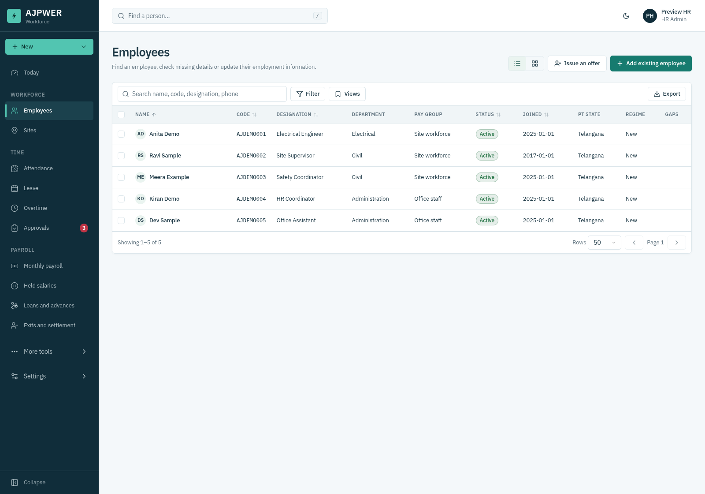

### Pay Groups

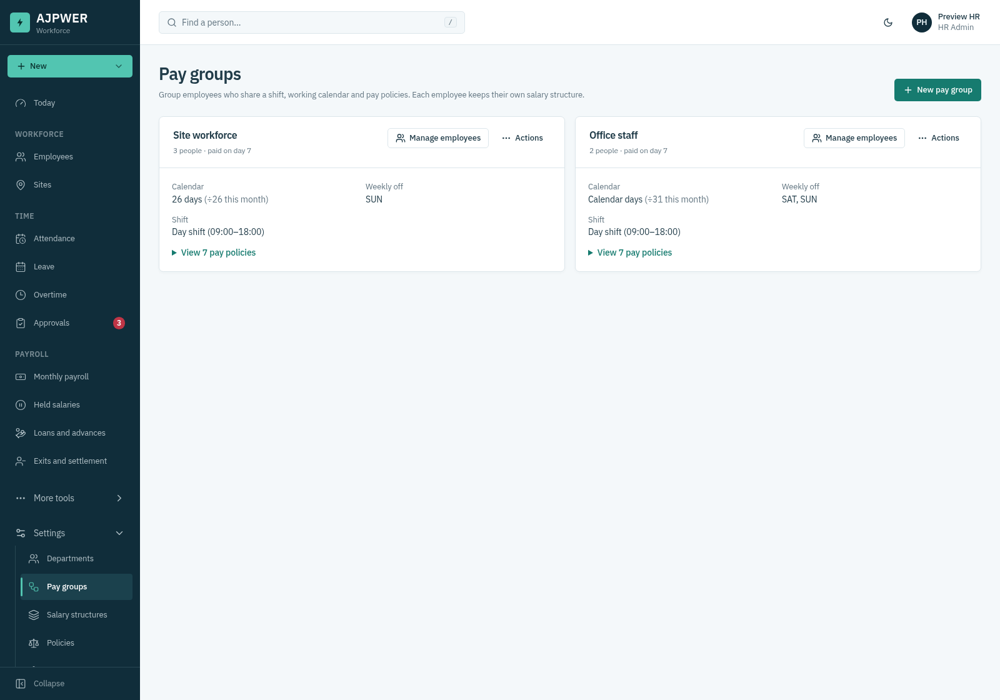

### Payroll Dark

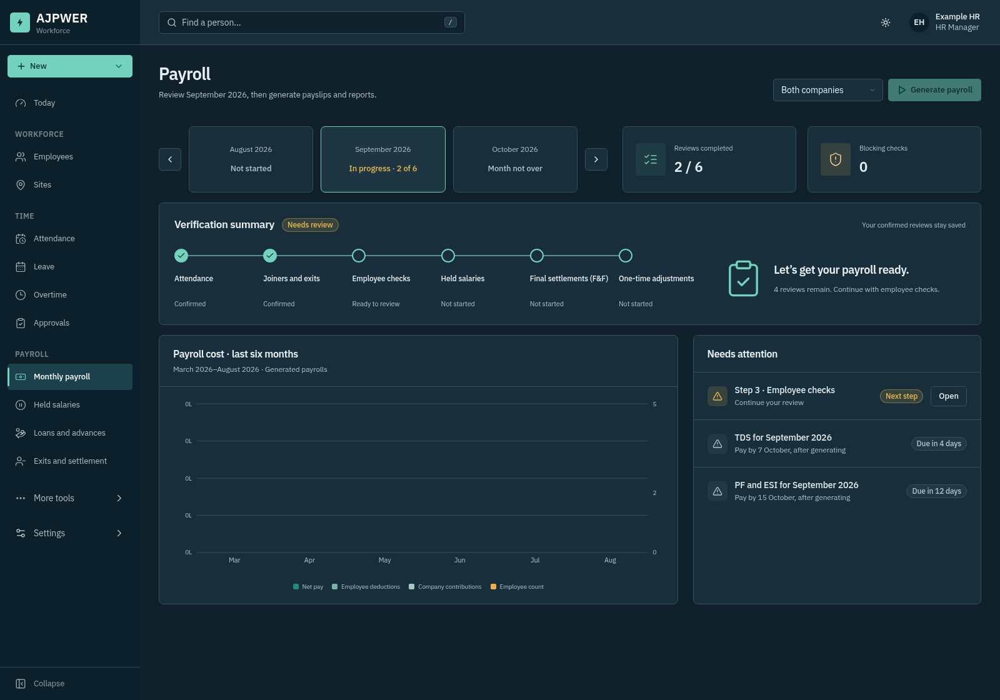

### Payroll Draft

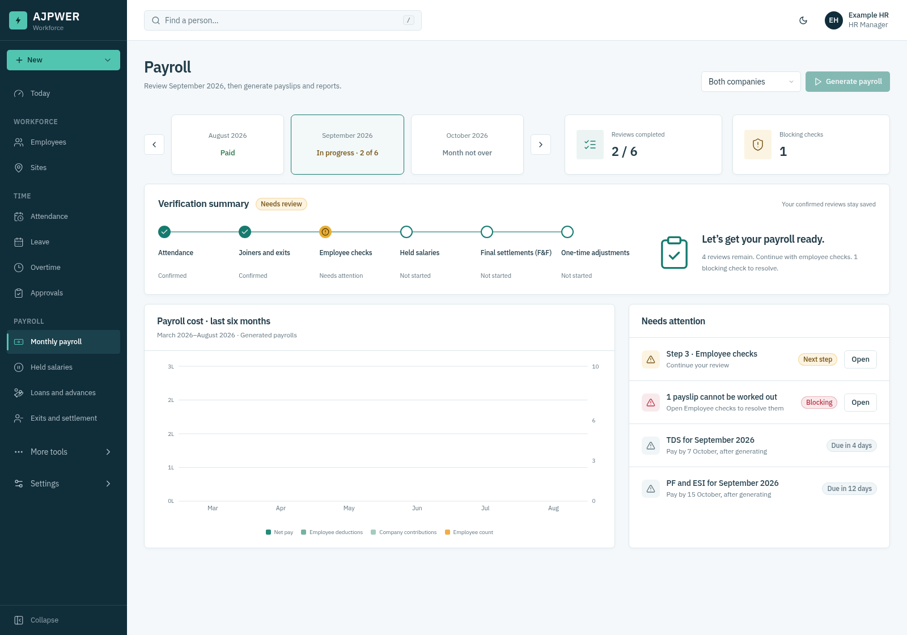

### Payroll Generated

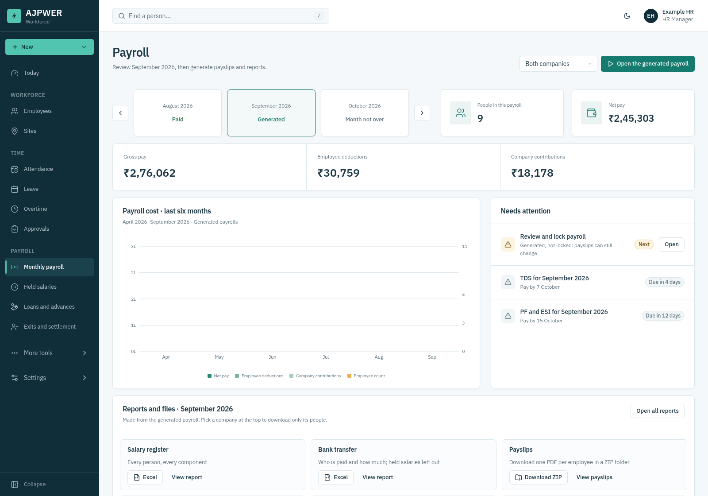

### Payroll Phone

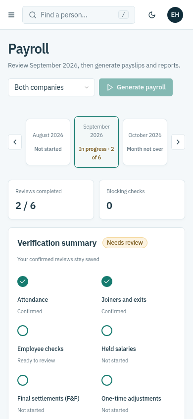

### Payroll Tablet

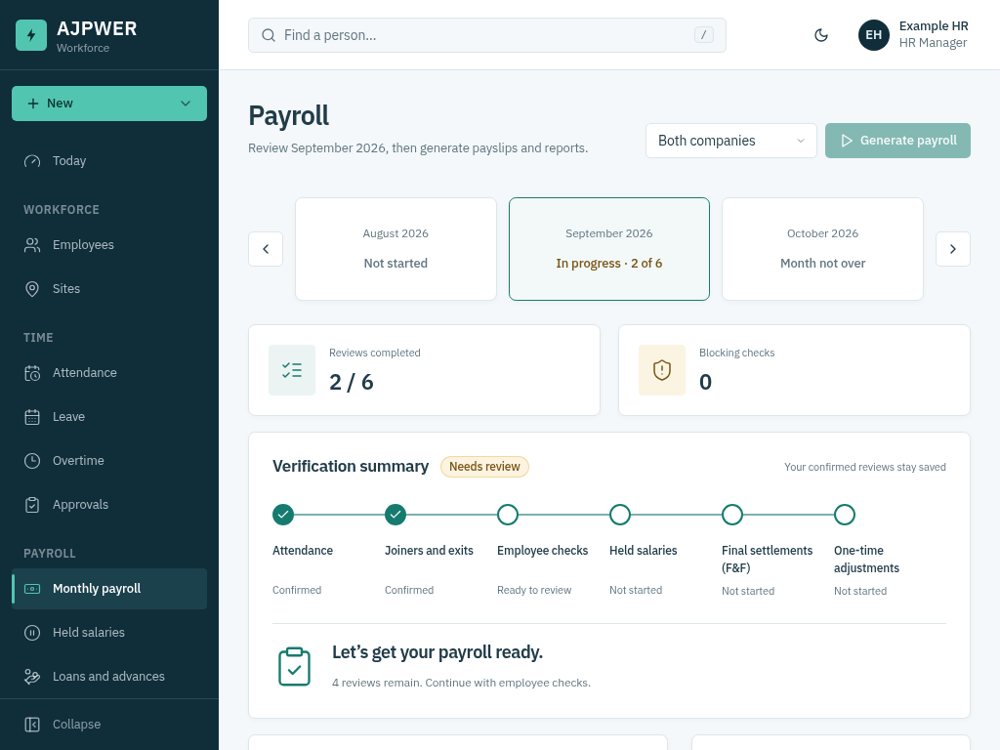

### Salary Structures

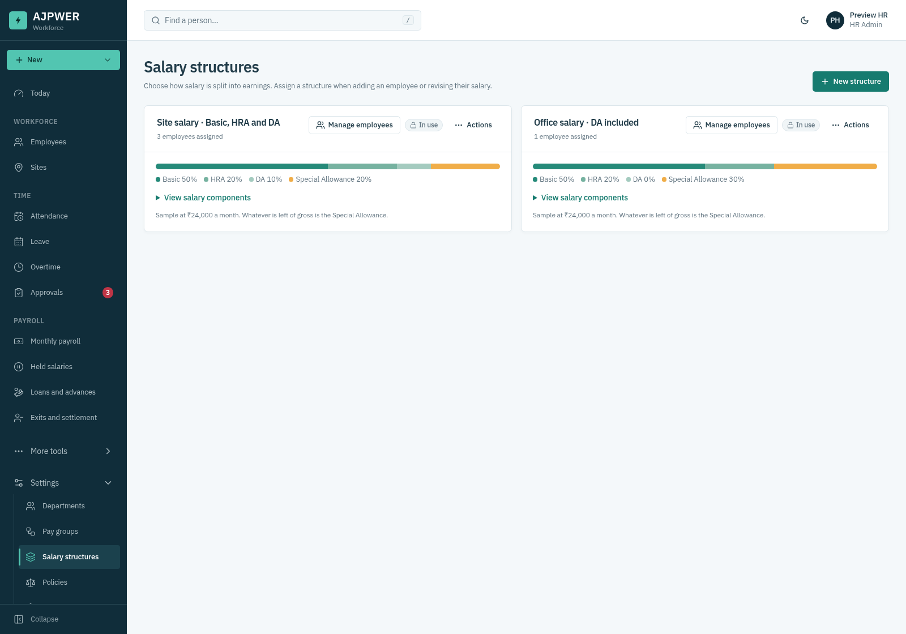

### Salary

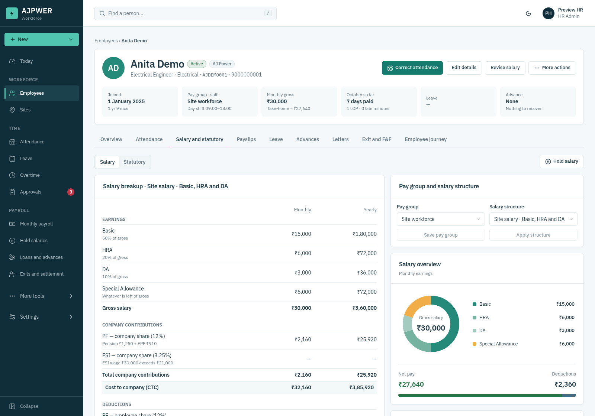

### Site Overview

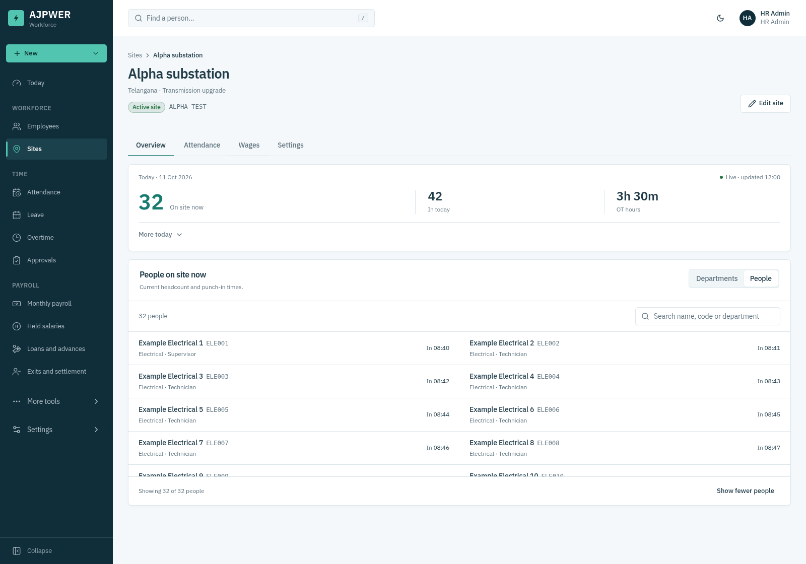

### Site Wages

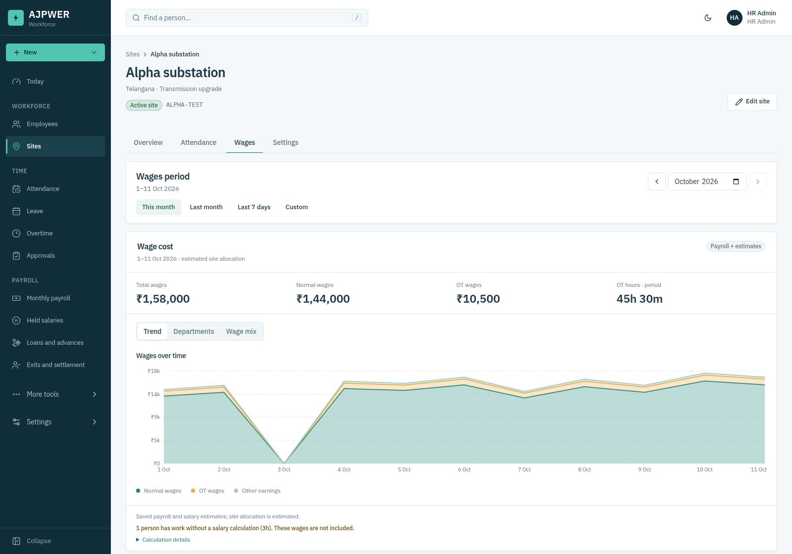

