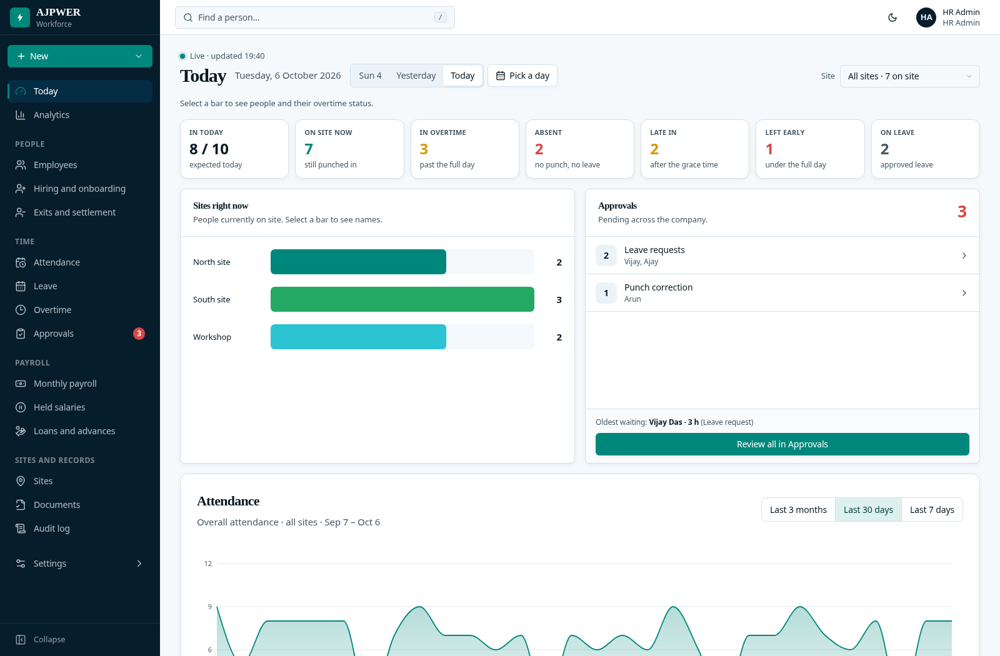
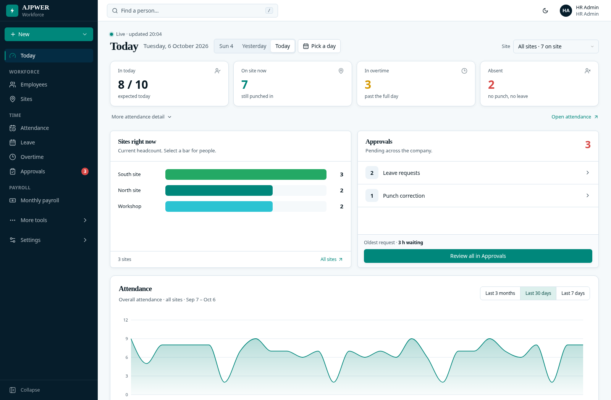
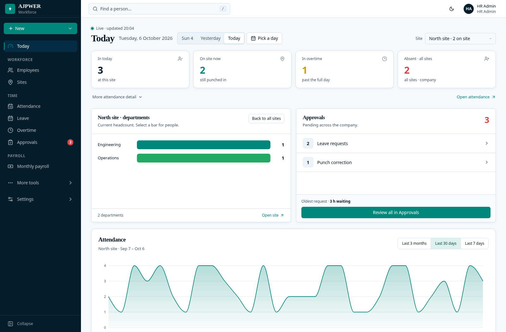
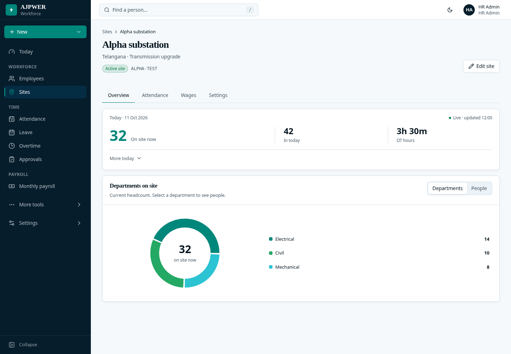
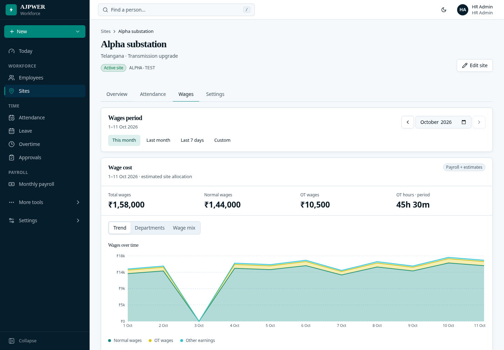
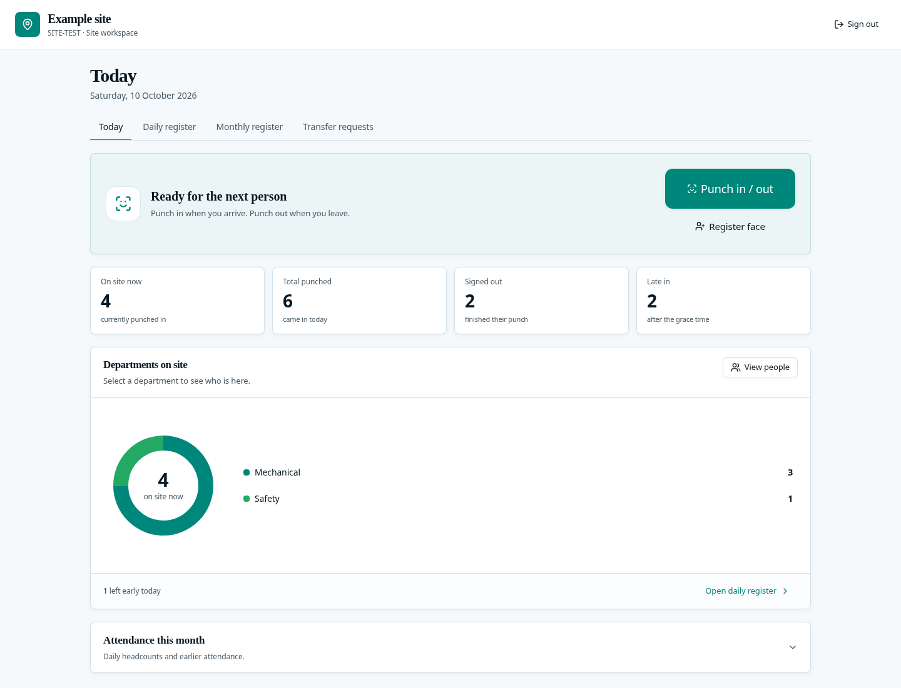
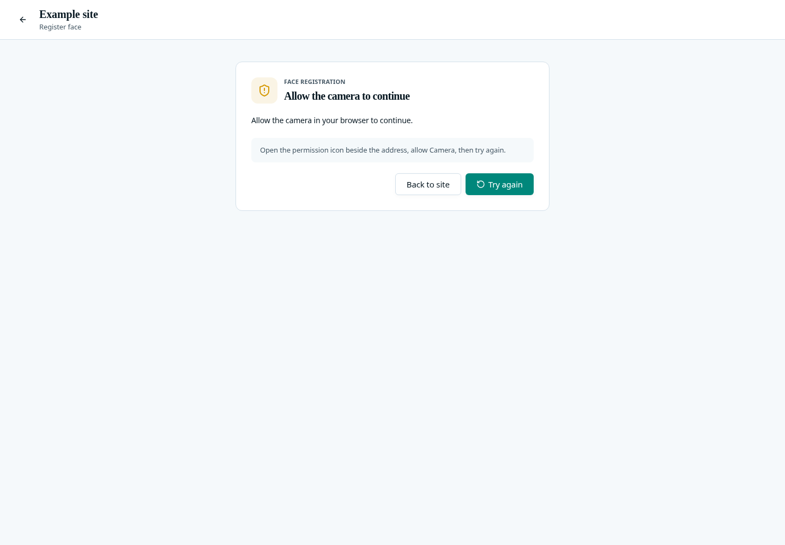
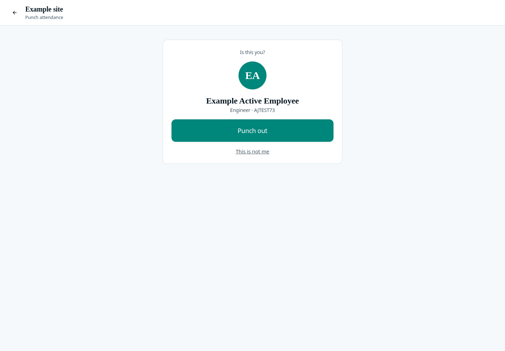

# Clearer AJPower screens

The main views show the information needed for the next decision. Detailed
records, charts and settings stay one action away. AJPower's existing navy/teal
colours and fonts are preserved.

The screenshots below use fictional employee and attendance data. You can view
them directly on GitHub. For the interactive Today preview, pull this branch and
open [`docs/designs/today-interactive.html`](../today-interactive.html) in a
browser; no server is required for that preview. GitHub displays HTML as source.

## Today

Four primary figures show arrivals, current headcount, overtime and absence.
**More attendance detail** reveals late arrivals, early departures and leave.
Choose a site to switch the same headcount card to its departments. Select a
number or bar to open the scoped people list, then attendance correction.
Company-wide absence and leave remain labelled when viewing one site.

Sites and Approvals have matching cards. Long headcount lists start with five
rows; **Show all** preserves the chosen date and site. One attendance curve
shows the company total or the selected site. Less frequent navigation remains
under **More tools**.

**Before**

**After**

**A selected site**

## Sites

Site cards start with current headcount and today's arrivals. Open a site for
**Overview**, **Attendance**, **Wages** or **Settings**. Overview shows one
department view; the people list has a short preview and explicit expansion.
Additional daily figures are behind **More today**.

Wages shows one selected view: trend, departments or wage mix. **Show figures**
replaces the chart with the values, rather than repeating both on the page.
Period filters, normal wages, OT wages and OT hours retain their calculations.
Location, geofence and login controls remain under Settings.

**Site overview**

**Wages for a chosen period**

[Browse the site screenshots](screens/sites/)

## Site tablet and face capture

The main tablet action is **Punch in / out**. Face registration is secondary.
The default site view shows a compact summary and departments; people open on
request. Daily/monthly registers and transfer requests remain separate views.

The face flow keeps its purpose and selected employee when a recoverable error
occurs. Camera permission, missing camera, camera in use, service unavailable and
location problems have different recovery instructions. Cancel remains available
while the browser waits for camera permission. A late camera response is released
after cancellation, and failed playback releases the captured camera tracks.
A cancelled permission request cannot replace a newer active camera preview.

An identified employee confirms the actual punch direction before the attendance
request is recorded. An already-recorded punch is a neutral result; duplicate
face registration is a warning with the next action. HR-approved re-registration,
active-employee checks, liveness, geofence and repeat-punch protection remain in
place. This change does not replace the recognition model or its thresholds.

**Site home**

**Camera recovery**

**Punch confirmation**

[Browse the tablet and face-flow screenshots](screens/tablet/)

## References used

The reference was used for layout principles, rather than reproducing its page.
Public websites were blocked by the workspace proxy; their accessible public
source repositories supplied the material reviewed here.

- [tweakcn: four summary cards](https://github.com/jnsahaj/tweakcn/blob/main/components/examples/dashboard/components/section-cards.tsx)
- [tweakcn: area chart and range controls](https://github.com/jnsahaj/tweakcn/blob/main/components/examples/dashboard/components/chart-area-interactive.tsx)
- [tweakcn: tabs, pagination and detail sheet](https://github.com/jnsahaj/tweakcn/blob/main/components/examples/dashboard/components/data-table.tsx)
- [MDN: camera permissions and failure states](https://github.com/mdn/content/blob/main/files/en-us/web/api/mediadevices/getusermedia/index.md)
- [MDN: accessible status messages](https://github.com/mdn/content/blob/main/files/en-us/web/accessibility/aria/reference/roles/status_role/index.md)

## Verification

Browser checks cover scoped headcounts, progressive disclosure, mobile layout,
existing attendance chart behavior, site wage views and face-flow recovery.
Face/site API checks use the isolated test database. Camera resource tests mock
browser streams. The Python service tests retain the existing models; its two
real-photo tests require separately supplied test images.

Validated: production frontend build, 59 browser checks, 405 engine checks,
66 face/site API checks and 26 Python checks passed (two photo checks skipped).

These checks verify the workflow and safety boundaries. Camera quality,
recognition accuracy and low-light behavior still require a real device trial.
