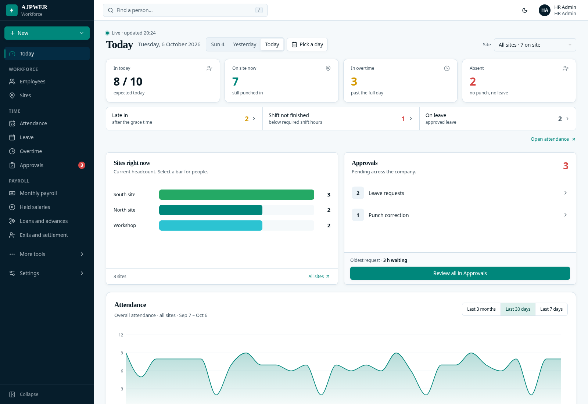
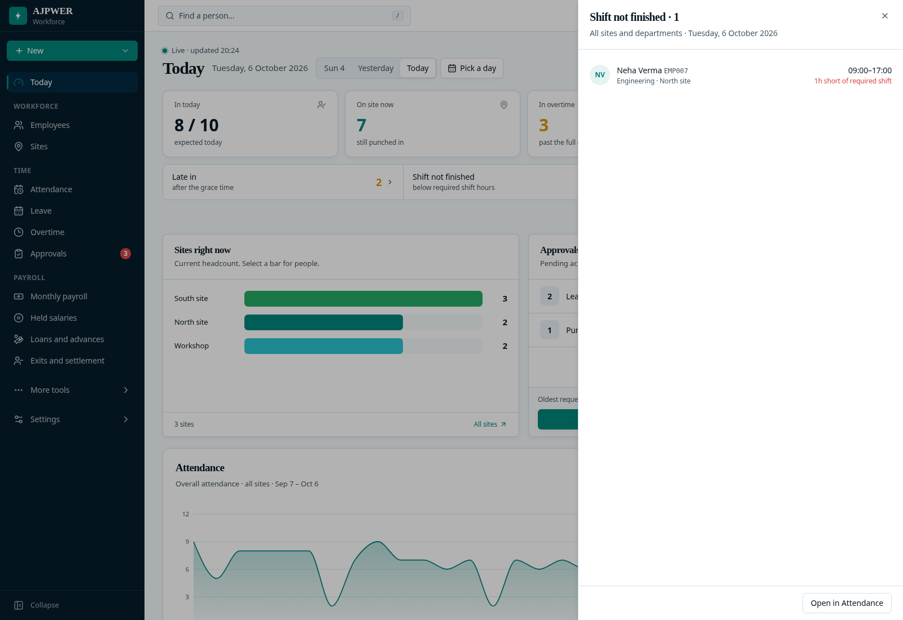
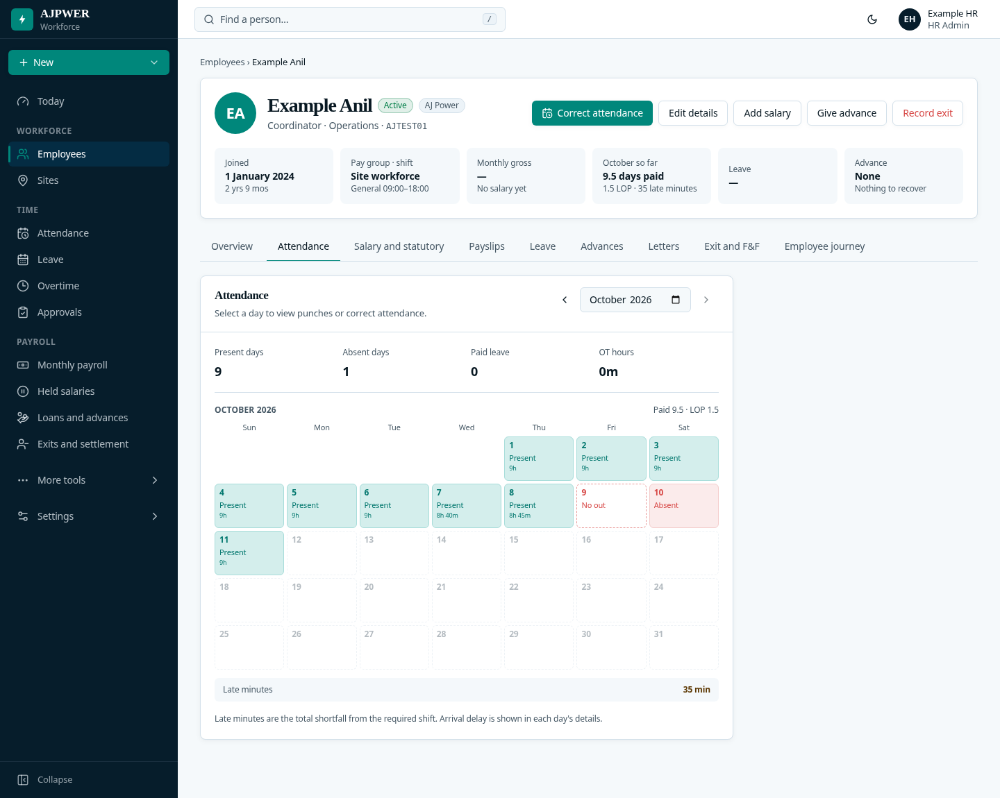
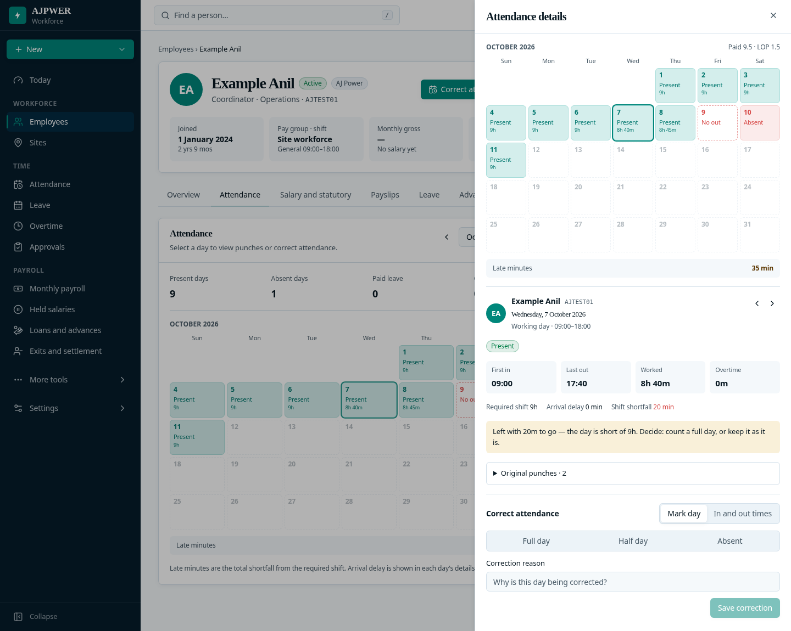
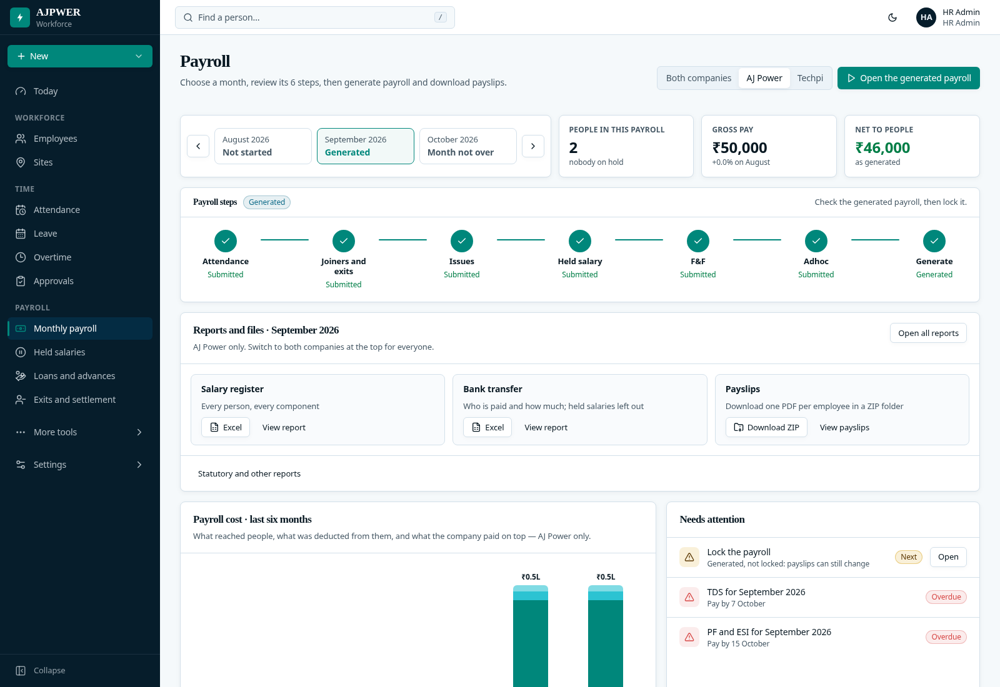
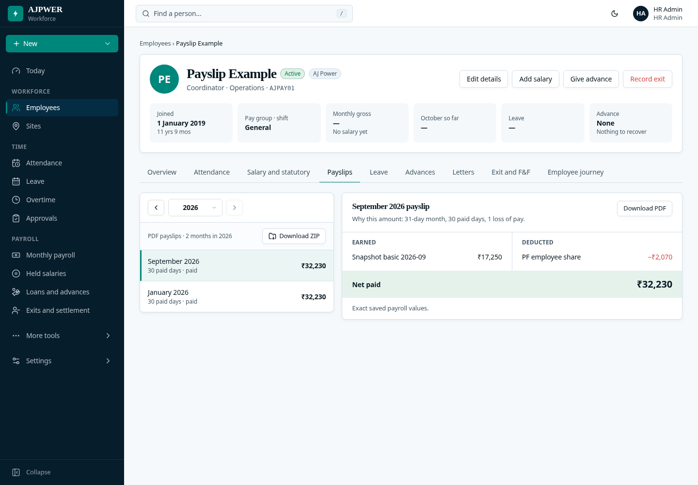
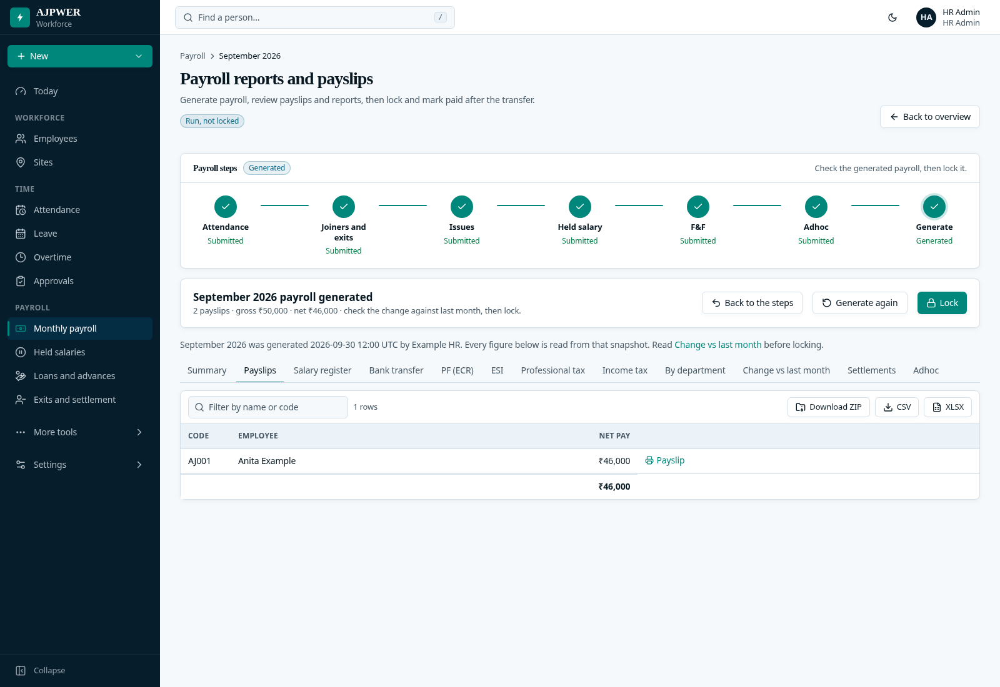
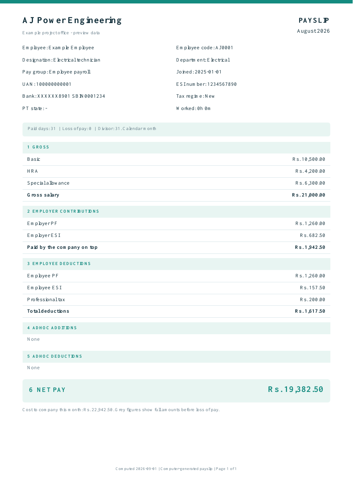

# Attendance, payroll and payslip downloads

These are the updated AJPower screens. All screenshots and the sample PDF use
fictional employees and amounts.

## Who came late or did not finish the shift

On **Today**, the row below the four main counts always shows **Late in**,
**Shift not finished** and **On leave**. Select a count to see names and minutes.
Select a person to open their attendance details and correction panel.

Late arrival and unfinished shift hours are separate. Someone who arrives late
but works the required hours is not a short shift. Open shifts and missing
punches are not counted as completed short shifts. Site and department filters
also apply to these lists.

## Correct an employee's attendance

Open **Employees → employee → Correct attendance** to review today directly.
For an earlier day, open the **Attendance** tab, choose the month and select the
day. Punch details and correction controls open in the same side panel.

The month calendar keeps its late-minute total below it. This total measures
required-shift shortfall. Enter a reason when saving a correction; original
punches are retained. Payroll locks and read-only access still apply.

## Find payroll and its reports

The sidebar's **Payroll** group contains **Monthly payroll**, **Held salaries**,
**Loans and advances**, and **Exits and settlement**.

Within Monthly payroll, choose the month and review Attendance, Joiners and
exits, Issues, Held salary, F&F and Adhoc. Generate follows these six reviews.
Report shortcuts now open the correct seventh stage. Each review has its own
description, and **Back to overview** returns to the month.

The generated month's overview shows Payslips, Salary register and Bank transfer.
**Statutory and other reports** reveals the remaining reports.

## Download PDF payslips in a ZIP folder

- **One employee:** open their **Payslips** tab, select a year, then **Download
  ZIP**. The ZIP contains that employee's available PDF payslips for that year.
- **A payroll month:** use **Download ZIP** in the overview's Payslips card, or
  **View payslips → Download ZIP**. The report download follows the selected
  company and name/code search.

Files are organised in employee-code folders and named with the month. The PDFs
read saved payroll figures. Generated, unlocked payslips are marked provisional;
locked or paid payslips are final. Downloads require payroll and export access.

[Sample PDF](payslip-example.pdf)

## Verification

Production backend/frontend builds, 48 browser checks, 418 engine checks and 27
payroll/attendance API checks passed. API tests use the isolated test database;
the imported employee preview data was not replaced or reseeded.
