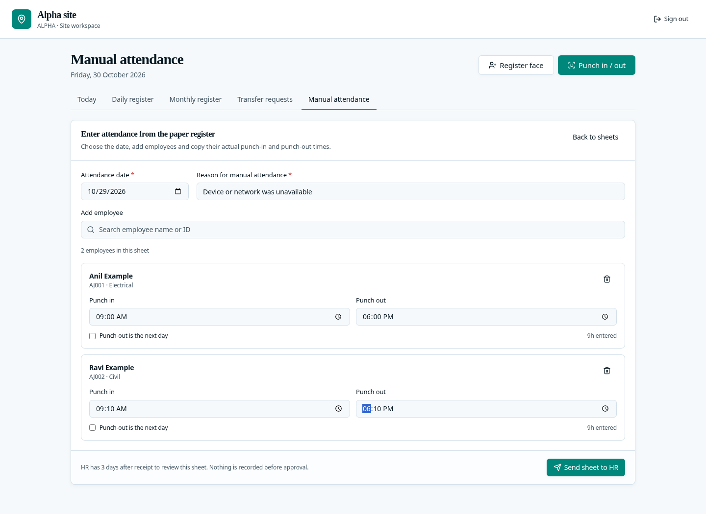
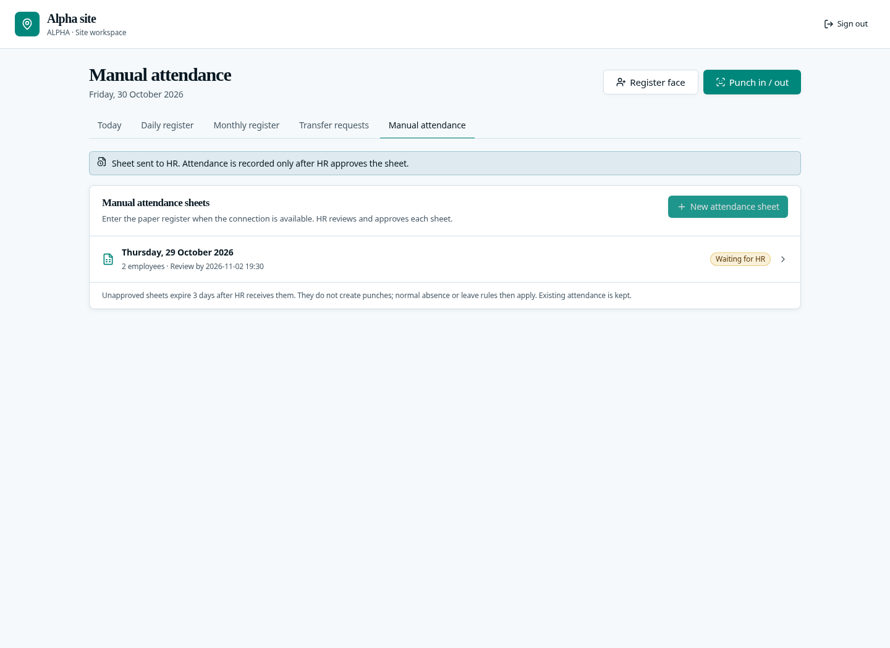
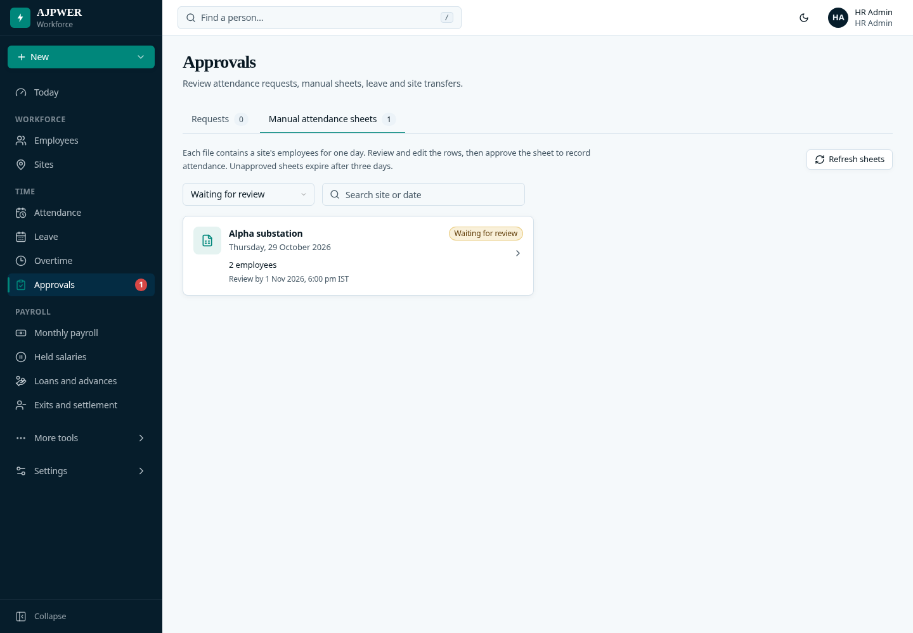
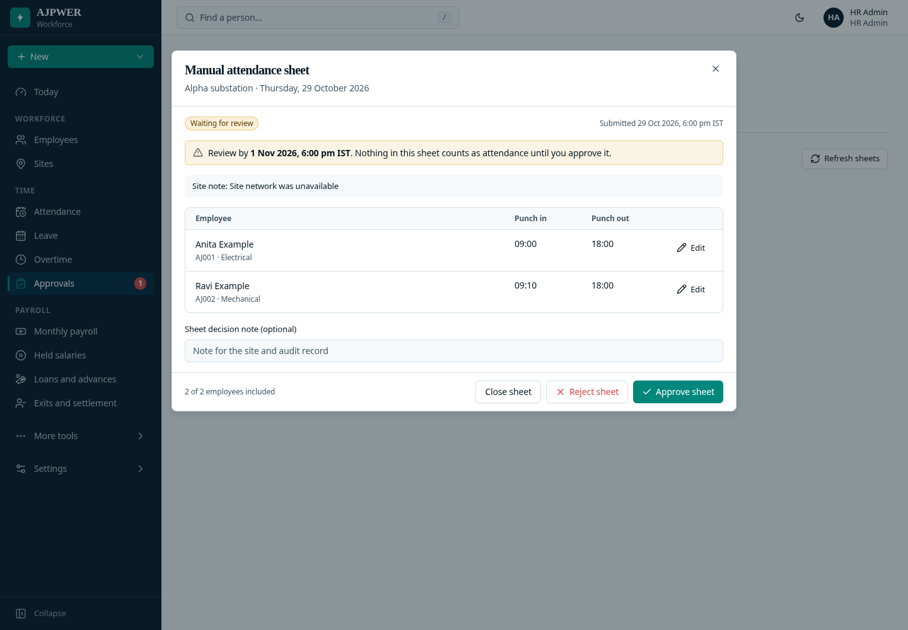
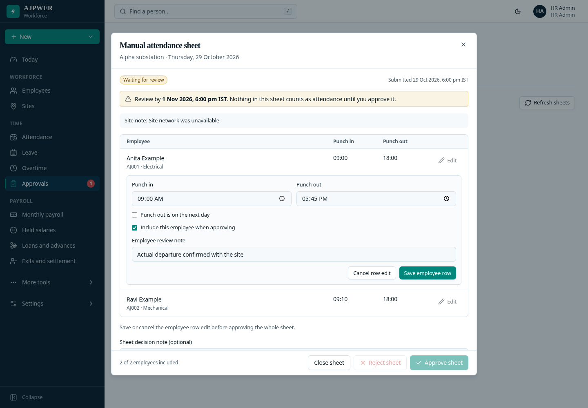
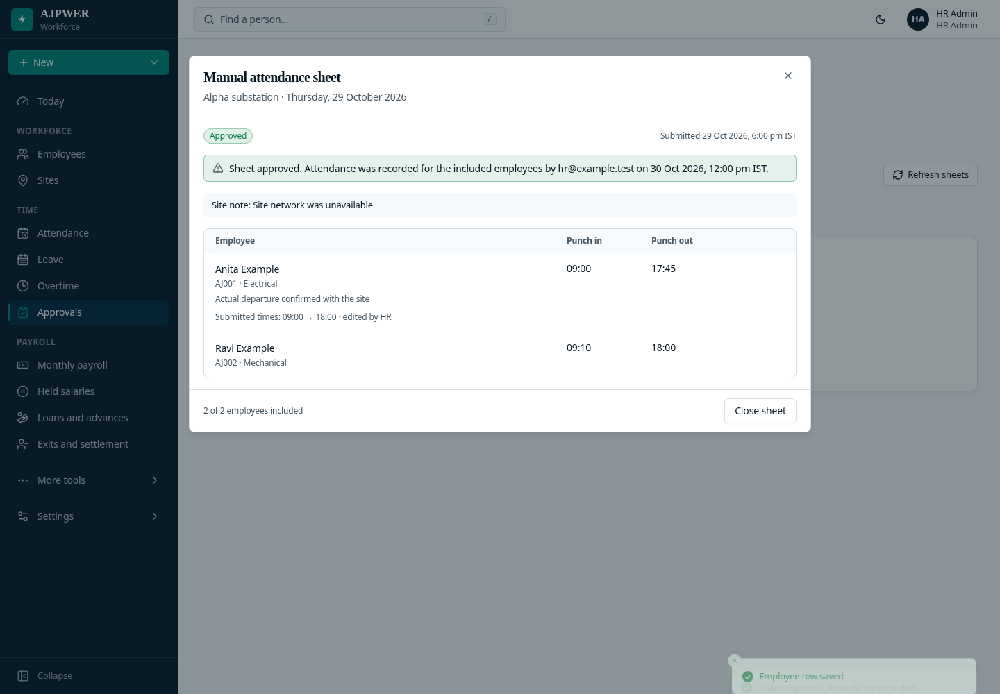
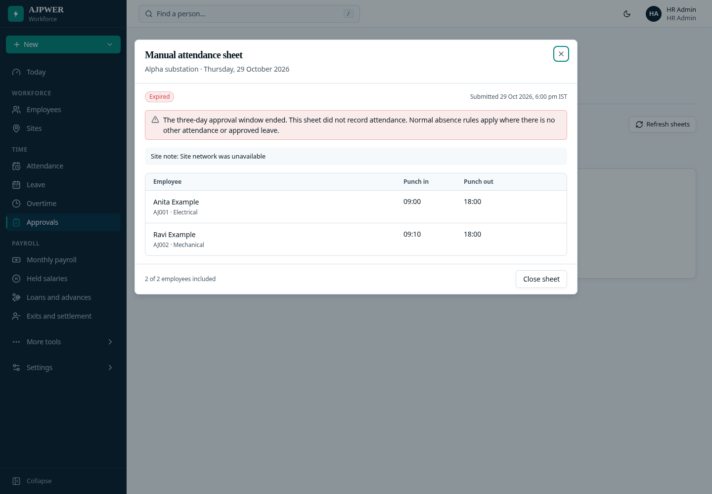

# Manual attendance from the paper register

Use the paper register during an outage. When internet is available, enter the
times in the site's **Manual attendance** screen and send the sheet to HR.

## At the site

1. Sign in to the site and open **Manual attendance**.
2. Start a sheet and choose the attendance date.
3. Search by employee name or code. Add each employee and enter their punch-in
   and punch-out times from the register. For an overnight shift, mark punch-out
   as the next day.
4. Enter the reason and select **Send sheet to HR**.
5. The sheet appears as **Waiting for HR**. The site's sent sheets show the
   subsequent approval, rejection or expiry.

Submission requires an internet connection and an explicit click. Reconnecting
does not send anything automatically. If a response is lost, retrying the same
submission cannot create a second sheet.





## HR review

Open **Approvals → Manual attendance sheets**. Each file represents a site and
date and contains its submitted employees.



Open a file to review every employee's times. Use the row's **Edit** action to
correct individual times, then save the row. The original site-entered times are
retained. A disputed employee can be excluded with a reason.





Select **Approve sheet** after reviewing it. Attendance is recorded for the
included employees together. If any row conflicts with existing attendance,
leave, a correction or a payroll lock, approval stops and identifies the issue;
other rows are not partially recorded.

A matching existing punch-in is retained when an outage prevented punch-out.
Only the missing punch is added. Normal attendance, overtime and payroll rules
calculate the result from the approved times.



## Three-day deadline

The review window is **72 hours from the server receiving the sheet**. Editing
a row does not extend it. Unapproved sheets expire and remain available under
**Expired** or **All sheets**.

An expired or rejected sheet creates no attendance. Employees without other
valid attendance or approved leave follow the normal absence rules. Existing
punches, leave and salary rules remain applicable.



Payroll attendance cannot be submitted while unexpired manual sheets for that
month await review. HR must approve, reject or let them expire first.

## Run this update locally

After pulling `feature/clean-hrms-experience`, run:

```sh
npm run db:migrate
npm run build
```

Restart the backend and frontend. The migration adds the sheet tables; employee
records and existing punches are retained.

The screenshots use fictional data. Validation covers permissions and site
isolation, row edits, complete-sheet approval, duplicate retries, expiry,
overnight times, matching existing punches and payroll locks. API checks run
against the isolated test database.

Production builds, 77 browser checks, 86 related API checks and 421 engine checks
passed. The 14 manual-sheet API checks also verify expiry during a lock wait and
whole-sheet rollback on conflicting rows.
